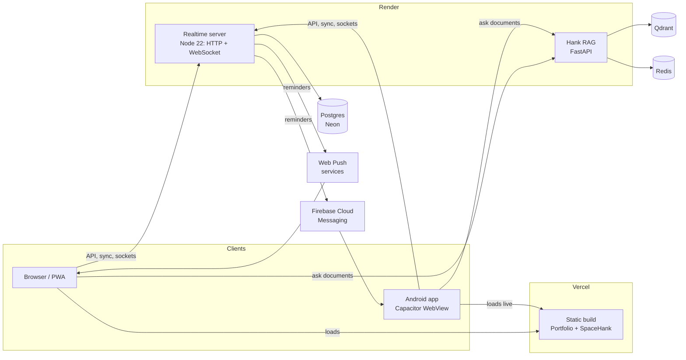

<div align="center">


# Hank62 — Portfolio & SpaceHank

**The personal portfolio of Võ Gia Huy, and the private workspace behind it.**
<br />
A bilingual (EN / VI) portfolio site, an installable workspace with 25+ tools, a realtime server, a RAG service and an Android app, all in one repository.

[](https://hank62dev.vercel.app)
[](public/changelog.json)
[](https://github.com/Hank62-dev/Portfolio/releases/latest)
[](https://github.com/Hank62-dev/Portfolio/actions/workflows/security.yml)
[](https://github.com/Hank62-dev/Portfolio/actions/workflows/android.yml)
[](https://github.com/Hank62-dev/Portfolio/commits/main)

[](https://react.dev)
[](https://vitejs.dev)
[](https://tailwindcss.com)
[](https://threejs.org)
[](https://capacitorjs.com)
[](https://nodejs.org)
[](https://neon.tech)
[](.integrations/hank62-rag)
[](https://vitest.dev)
[](https://web.dev/progressive-web-apps/)

[**Live site**](https://hank62dev.vercel.app) · [**Workspace demo**](https://hank62dev.vercel.app/spacehank?demo) · [**Android APK**](https://github.com/Hank62-dev/Portfolio/releases/latest) · [**Changelog**](public/changelog.json)

</div>

---

## Contents

- [Overview](#overview)
- [Features](#features)
- [Tech stack](#tech-stack)
- [Architecture](#architecture)
- [Getting started](#getting-started)
- [Scripts](#scripts)
- [Project structure](#project-structure)
- [Editing content](#editing-content)
- [Styling](#styling)
- [The Android app](#the-android-app)
- [Quality: tests, lint and CI](#quality-tests-lint-and-ci)
- [Deployment](#deployment)
- [Versioning and changelog](#versioning-and-changelog)
- [Documentation](#documentation)
- [Author](#author)

---

## Overview

One repository, several programs that share one design system and one build:

| Program | What it is | Where it lives | Runs on |
| --- | --- | --- | --- |
| **Portfolio** | The public site at `/`: work, lab, stack, activity, a small shop and contact | `src/portfolio/` | Vercel (static) |
| **SpaceHank** | A private workspace at `/spacehank`: notes, diary, tasks, music, AI, games and more; an installable PWA | `src/spacehank/` | Same Vercel build, loaded lazily |
| **Realtime server** | Sign-in, sync across devices, AI helpers, push, calendar, sockets, the storefront | `server/` | Render (Node 22) |
| **Hank RAG** | A Python service that answers questions from the owner's own documents | `.integrations/hank62-rag/` | Render (FastAPI, Qdrant, Redis) |
| **Android app** | A Capacitor shell around the live workspace, with native media, widget, reminders and self-update | `android/`, `app-shell/` | GitHub Actions → APK on Releases |

> Want to look around without an account? Open **[`/spacehank?demo`](https://hank62dev.vercel.app/spacehank?demo)**: the workspace with made-up data and no server.

## Features

### Portfolio (`/`)

- **Bilingual** English / Vietnamese, switchable from the navbar; every string lives in one data file.
- **Hero** drawn as an architect's exploded axonometric of the system, with hairlines that draw themselves in and plates that follow the pointer.
- **Work and Lab**: featured case studies with their own pages, lab experiments and an archive table, all generated from `projects.js`.
- **Stack, by evidence**: a periodic table of every tool actually used, where each element's number is how many projects used it. Nothing is hand-listed.
- **Activity**: live GitHub data (repositories, contributions), validated and cached, never padded with made-up numbers.
- **Store**: products, booking a call, memberships and a media kit, with payments confirmed by webhook.
- **Immersive** three.js scenes, GSAP and Lenis motion, all respecting `prefers-reduced-motion`.
- A **guestbook** ("Whispers") and an SEO setup: Open Graph image, canonical URL and sitemap.

### SpaceHank workspace (`/spacehank`)

| Area | Tools |
| --- | --- |
| **Workspace** | Hank 62 dashboard (today at a glance) · SpaceWorkAI (an agent office in 3D) · Hank RAG (ask your own notes) · Dev Pulse (repos, builds, uptime) · Git Bash (a terminal in the page) |
| **Knowledge** | Document Vault · Second Brain (rich-text notes) · Constellation (notes as a night sky) · Voice Memos · Memory Stream |
| **Create** | Image Studio · Creator Lab (content, clients and income) · Paint (layers) · Hank Music (offline library) · Podcast |
| **Life** | Calendar (two-way Google Calendar) · Mission Board (kanban) · Study Hub (flashcards, focus timer) · Habit Garden · Wallet (spending and budgets) · Nhật ký (diary) · Ra chơi (26 games, including online sea battle) |

Across the whole workspace:

- **Sync across devices** through the realtime server and Postgres, with an offline-first IndexedDB store.
- **Reminders that arrive with the app closed**: Web Push in browsers, Firebase Cloud Messaging on Android. The same rules file runs in the browser and on the server, so the two always agree.
- **Command palette**, natural-language commands, quick capture and keyboard shortcuts.
- **Installable PWA** with offline support, home-screen shortcuts, a share target and an in-app update notice with "what's new".
- **Light and dark themes**, palettes and wallpapers. English and Vietnamese, with every string checked by tests.

### Android app

- Opens straight into the workspace and **keeps the sign-in** across restarts.
- **Reminders on time**: the next two days are set as exact alarms, so they come with the app closed, offline or after a restart. With the server's FCM switched on, the server sends them instead.
- **Music and podcasts keep playing with the screen off**, with a media card on the notification shade and lock screen, plus headset and Bluetooth buttons. No player was rewritten: a bridge carries `navigator.mediaSession` to a native media session.
- **"Today" home-screen widget**: events still to come, overdue and due tasks, habits still waiting. Each row opens its tab.
- **Share into Hank62** from any app (text, links, pictures).
- **Updates itself**: an Update pill downloads the newest APK in the background with progress, checks it is this app and newer, then Android asks once.
- A battery-saver guide for phones that stop background apps.

## Tech stack

| Layer | Technologies |
| --- | --- |
| **Interface** | React 18, React Router 7, Tailwind CSS 4, Radix UI primitives, lucide-react, TipTap, three.js / react-three-fiber / drei, GSAP, Lenis, i18next |
| **App shell** | Vite 5, vite-plugin-pwa (Workbox), Capacitor 8 (Android), Java (native plugin, media service, widget) |
| **Server** | Node.js 22 (plain `http` + `ws`), web-push, Firebase Cloud Messaging HTTP v1, node-ical, Google Calendar API, Gemini |
| **Data** | PostgreSQL (Neon), IndexedDB on the device, Qdrant (vectors), Redis (cache and conversation memory) |
| **RAG service** | Python, FastAPI, google-genai, qdrant-client, Redis |
| **Quality** | Vitest (unit, integration and characterization tests, PGlite for real SQL), ESLint 9, GitHub Actions |
| **Hosting** | Vercel (site and workspace), Render (server and RAG), GitHub Releases (APK) |

## Architecture



Layering is enforced: lower layers never import higher ones, and `src/test/architecture.test.js` checks every import on each run (no cycles, no missing files, no layer crossed the wrong way).

```
shared   <   portfolio            <   app
shared   <   spacehank/core  <  spacehank/ui  <  spacehank/features  <  spacehank/layout  <  spacehank/app  <  app
server/http  <  server/services  <  server/routes  <  server/app.mjs
```

The full map, the conventions and where each kind of code goes are in **[`ARCHITECTURE.md`](ARCHITECTURE.md)**.

## Getting started

### Prerequisites

- **Node.js 22** and npm
- For the server: a `.env` with at least `SPACEHANK_PASSWORD` and `SPACEHANK_ORIGIN` (and `DATABASE_URL` for sync and push)
- For the Android app (optional): JDK 21 and the Android SDK, or let GitHub Actions build it

### Run the site and the workspace

```bash
git clone https://github.com/Hank62-dev/Portfolio.git
cd Portfolio
npm install
npm run dev            # http://localhost:5173
```

Open `/` for the portfolio and `/spacehank?demo` for the workspace with sample data.

### Run the realtime server

```bash
npm run spacehank:hash-password   # optional: store a hash instead of the plain password
npm run spacehank:server          # http://localhost:8787
```

Point the front end at it with `VITE_SPACEHANK_API_URL` and `VITE_SPACEHANK_WS_URL`. Every variable, where to get it and what is free is in **[`SPACEHANK_SETUP.md`](SPACEHANK_SETUP.md)**.

## Scripts

| Command | Does |
| --- | --- |
| `npm run dev` | Vite dev server with hot reload |
| `npm run build` | Production build to `dist/` (with the service worker) |
| `npm run preview` | Serves the production build locally |
| `npm run spacehank:server` | Starts the realtime server (reads `.env`) |
| `npm run spacehank:hash-password` | Prints a hash for `SPACEHANK_PASSWORD` |
| `npm run lint` | ESLint over the whole repository |
| `npm test` | The whole Vitest suite (front end and server) |
| `npx cap sync android` | Copies the app shell and plugin list into `android/` |

## Project structure

```
src/
├─ app/          start-up, routes, layout, the update notice
├─ shared/       design system (ui/), i18n, lib, hooks, styles: used by both apps, imports neither
├─ portfolio/    the public site: pages, sections, scene (three.js), motion, data, services
├─ spacehank/    the workspace: core (stores, sync, api, i18n), ui, features/<tab>, layout, app
├─ assets/       bundled music, sounds, the logo
└─ test/         whole-repo tests: architecture and characterization

server/          the realtime server: http/, services/, routes/, app.mjs, config.mjs
android/         the Capacitor Android project (Java: Hank62Plugin, MediaService, TodayWidget)
app-shell/       the tiny page bundled in the APK (shown when the live site cannot load)
assets/          icon and splash sources for the Android app
public/          static files: icons, og.png, changelog.json, android.json, the service worker extension
.integrations/   hank62-rag, the Python RAG service (its own project)
```

## Editing content

All content is data: routine updates never touch a component.

| To change… | Edit |
| --- | --- |
| Profile facts, socials, email | `src/shared/profile.js` |
| Projects, lab items, archive rows | `src/portfolio/data/projects.js` |
| Headlines and interface text (EN / VI) | `src/portfolio/data/copy.js` |
| Workspace text in Vietnamese | `src/spacehank/core/i18n/locale/vi*.js` |
| Colours, type scale, spacing, breakpoints, keyframes | `src/shared/styles/index.css` (`@theme`) |

A project is `{ slug, tier, name, year, kind, tagline, summary, role?, decisions[], layers, links[], cover }`.

- `tier` is one of:
  - `featured`: home list and a case page
  - `lab`: Lab section and a case page
  - `archive`: a table row
- `layers` (`interface` / `service` / `data` / `delivery`) feeds the **Stack** section. That section is generated: a technology appears only if a project lists it.
- Leave out what you cannot verify (`role`, `decisions`, `cover` are optional).
- Old numeric ids (`/projects/1`) still resolve.

## Styling

Everything is Tailwind utility classes in the JSX, with no CSS Modules. `src/shared/styles/index.css` holds:

- **`@theme`**: the design tokens as utilities, for example `bg-ink-1`, `text-bone-dim`, `text-signal`, `font-display`, `text-h2`, `px-gutter`, `py-section`, `ease-out-expo`, `animate-marquee`.
- **Breakpoints**:
  - `xs 560`, `sm 640`, `md 760`, `nav 860` (where the menu collapses), `lg 1000`, `xl 1100`
  - `md` is **760**, not Tailwind's default 768.
- **Custom variants**:
  - `in:` inside a scroll-revealed element
  - `unrevealed:` JS is running but the element is not revealed yet
  - `fine:` a real mouse
- **Custom utilities**: `wrap`, `mono`, `serif-accent`, `line-mask`, `enter`, `page-in`.
- The few rules that need runtime state (`html.js`, `[data-reveal]`), and the `prefers-reduced-motion` block.

## The Android app

The app is a Capacitor WebView that loads the **live** workspace (`capacitor.config.json` → `server.url`). Web changes reach the app as soon as they deploy, with no new APK. A new APK is only needed when the native shell changes.

| Part | File |
| --- | --- |
| The native plugin (media, widget, sharing, battery, self-update) | `android/app/src/main/java/dev/hank62/app/Hank62Plugin.java` |
| Media session and foreground service | `android/.../MediaService.java` ↔ `src/spacehank/features/android/media.js` |
| Today widget | `android/.../TodayWidget.java` ↔ `src/spacehank/features/android/widget.js` |
| Reminders as alarms, FCM registration | `src/spacehank/features/notifications/native.js` |
| Self-update | `src/spacehank/features/android/updater.js`, `ApkUpdate.jsx` |

**Building.** `.github/workflows/android.yml` builds the APK on every change to `android/`, `app-shell/`, `capacitor.config.json` or `public/android.json`. You can also start it by hand from the Actions tab. Every signed build from `main` is published to **[Releases](https://github.com/Hank62-dev/Portfolio/releases/latest)**.

The workflow needs these repository secrets:

| Secret | What it is |
| --- | --- |
| `ANDROID_KEYSTORE_BASE64` | The signing keystore, base64. Keep a backup: a lost key means updates no longer install over the old app |
| `ANDROID_KEYSTORE_PASSWORD`, `ANDROID_KEY_ALIAS`, `ANDROID_KEY_PASSWORD` | Its passwords and alias |
| `GOOGLE_SERVICES_JSON_BASE64` | Firebase's `google-services.json`, base64. It is kept out of the repo, where its API key would trip the secret scan |

The server sends to the app with `FCM_SERVICE_ACCOUNT`: a Firebase service-account JSON, set on Render.

**Shipping a native change.** Bump both numbers in the same commit, and installed apps will offer the update:

1. `SHELL` in `Hank62Plugin.java`
2. `shell` in `public/android.json`

The full plan, phases and limits are in [`ANDROID_APP_PLAN.md`](ANDROID_APP_PLAN.md).

## Quality: tests, lint and CI

```bash
npm run lint && npm test     # before every deploy
```

- **Unit and integration tests** sit beside the code (`model.js`, `store.js`, services, routes). Server SQL runs against a real in-process Postgres (PGlite).
- **Characterization tests** pin what every screen renders and every translated string, so a refactor cannot change behaviour by accident.
- **The architecture test** guards the import layers.
- **i18n coverage**: every English string has a Vietnamese one, checked by `coverage.test.js`.

**CI** (GitHub Actions):

| Workflow | Runs |
| --- | --- |
| [`security.yml`](.github/workflows/security.yml) | On every push and pull request, and weekly. `npm audit` for shipped libraries, plus a scan of the whole history for keys and tokens |
| [`android.yml`](.github/workflows/android.yml) | Builds, signs and releases the APK |

## Deployment

| Piece | Host | Notes |
| --- | --- | --- |
| Site and workspace | **Vercel** | Static build. `vercel.json` rewrites unknown paths to `index.html` and sets the security headers and CSP |
| Realtime server | **Render** | `render.yaml`. Needs `SPACEHANK_PASSWORD`, `SPACEHANK_ORIGIN`, and optionally `DATABASE_URL`, VAPID keys, `FCM_SERVICE_ACCOUNT`, calendar and AI keys |
| Hank RAG | **Render** | `.integrations/hank62-rag/` (has its own Dockerfile and `docker-compose.yml`) |
| Android APK | **GitHub Releases** | Built by `android.yml` |

The step-by-step guide, the post-deploy checklist and what the free tiers allow are in **[`DEPLOYMENT.md`](DEPLOYMENT.md)**. The security checklist (sessions, origin checks, rate limits, headers and CSP, SSRF-safe fetch) is in **[`SECURITY.md`](SECURITY.md)**.

## Versioning and changelog

Each commit that ships comes with:

- A **version bump** in `package.json`.
- An entry at the top of **[`public/changelog.json`](public/changelog.json)**, in both English and Vietnamese. Internal-only changes are marked `"internal": true`.

The workspace reads the changelog to show "what's new" after an update.

## Documentation

| Document | Covers |
| --- | --- |
| [`ARCHITECTURE.md`](ARCHITECTURE.md) | The tree, the import layers, conventions, languages, tests |
| [`DEPLOYMENT.md`](DEPLOYMENT.md) | Vercel and Render, push, the storefront, post-deploy checks |
| [`SPACEHANK_SETUP.md`](SPACEHANK_SETUP.md) | Setup from zero with every environment variable (Vietnamese) |
| [`ANDROID_APP_PLAN.md`](ANDROID_APP_PLAN.md) | The Android app: design, phases, signing, limits (Vietnamese) |
| [`PHONE_TESTING.md`](PHONE_TESTING.md) | Trying the web on an Android phone over a cable |
| [`SECURITY.md`](SECURITY.md) | The security checklist: what is done, what is partial, what is left (Vietnamese) |
| [`CREATOR_STRATEGY.md`](CREATOR_STRATEGY.md) | The thinking behind Creator Lab and the storefront (Vietnamese) |

## Author

**Võ Gia Huy** ([Hank62-dev](https://github.com/Hank62-dev)): design, code and everything in between.

- Portfolio: [hank62dev.vercel.app](https://hank62dev.vercel.app)
- GitHub: [@Hank62-dev](https://github.com/Hank62-dev)

<sub>No licence file is included: the code is shared to read and learn from, and all rights are reserved.</sub>
